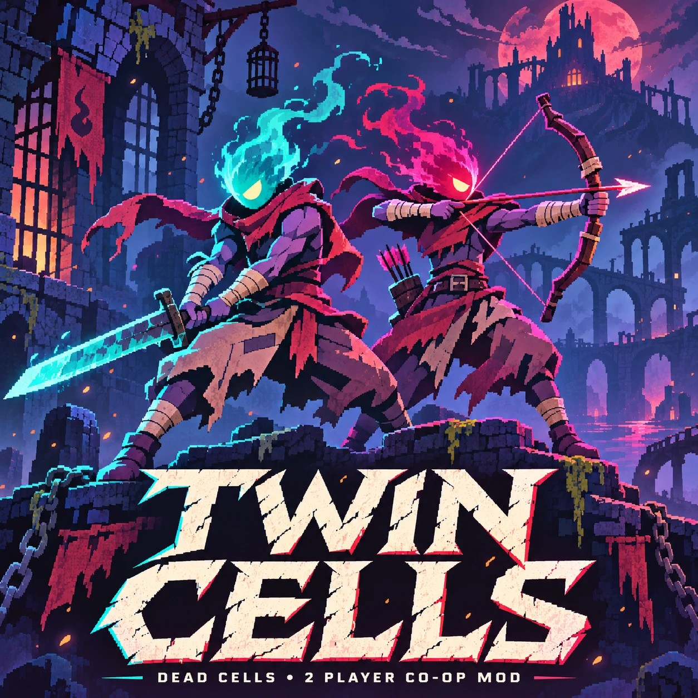

# Twin Cells

**A two-player co-op overhaul for Dead Cells.** [Русская версия](README_ru.md)

**Alpha.** Current build: 0.1.0-alpha, release **Alpha1** (2026-11-11). Windows only.

Twin Cells is a set of fixes and additions for two-player co-op in Dead Cells, packed into one mod. It is an add-on for the community co-op mod **DeadCellsMultiplayerMod 0.5.1** and does not work without it.

> **About the name.** In the current alpha build the in-game module still has its technical name, **CoopPack**: the file is `CoopPack.dll`, its log lines start with `[CoopPack]` and its switches are called `COOP_PACK_*`. The module will be renamed in the next version. Until then, "CoopPack" in this repository means the Twin Cells module.

## Credits

Twin Cells is built on the work of other developers:

- **[DeadCellsMultiplayerMod](https://github.com/vaiserYT/DeadCellsMultiplayerMod)** by **vaiserYT (Alexey)**, MIT licence. That mod is what makes co-op possible at all: connecting, lobby sessions and synchronising players and enemies. Twin Cells is built on top of its 0.5.1 release. **The base mod's files and source code are not modified.** Its DLL is used unchanged from its official 0.5.1 release, and every Twin Cells part is an add-on that runs next to it. At run time, some parts patch specific base-mod methods with Harmony (see [THIRD-PARTY-NOTICES.md](THIRD-PARTY-NOTICES.md)).
- **[Dead Cells Core Modding (DCCM)](https://github.com/dead-cells-core-modding/core)** 35.13.5 by the Dead Cells Core Modding contributors, MIT licence. DCCM is the mod loader Twin Cells runs on.
- **Dead Cells** is a game by Motion Twin / Evil Empire and belongs to its rights holders. Twin Cells is an unofficial fan project. It is not affiliated with or endorsed by Motion Twin, Evil Empire or the game's other rights holders. It is also not an official part of DeadCellsMultiplayerMod or DCCM, so please report Twin Cells problems here, not to those projects.
- **You need your own copy of Dead Cells on Steam.** This repository contains no game files.

Licences and credits for these projects are in [THIRD-PARTY-NOTICES.md](THIRD-PARTY-NOTICES.md).

## What Twin Cells is

Earlier releases of these fixes were up to 18 separate DCCM mods. Twin Cells replaces them with **one** mod folder, `coremod\mods\CoopPack` (`CoopPack.dll`, `CoopSteamInviteWorker.dll`, `modinfo.json`). That folder holds **19 parts compiled into one assembly**:

- Each part is built from the same sources as its separate module. For CoopOpt and the new CoopLobby, these are the unreleased separate builds that were used in testing. The reviewed edits change only three things: how the parts find each other, the GameProxy fingerprint roots (which the separate modules read from their own DLL files and which are now fixed in `src/inputs/roots/`), and two shared services (one shared `GameProxy.dll` check and memoised file hashing).
- The pack loader isolates failures. If one part fails to install, the game and the other parts keep running. If a part's per-frame update keeps failing, that part is switched off for the rest of the session.
- Every part has its own switch that turns it off for one launch when set to `1`, for example `COOP_PACK_OPT_DISABLE=1` for CoopOpt or `COOP_PACK_FRAME_DISABLE=1` for CoopFrameFix. A switch name does not always repeat the part name, so check the exact names of all 19 switches in `src/pack/PartTable.g.cs`. `COOP_PACK_DISABLE=1` switches off the whole pack.
- In the test runs, the game started faster with the pack: the host log's median start-up time was 4 s with the pack and 18 s with the separate mods.

### The 19 parts

| Part | What it does |
|---|---|
| CoopSyncFixes | The largest set of world-sync fixes: level and route transitions, joining a run in progress, doors, elevators, enemy and elite deaths, enemy registry batches, map history, weapon identity, sleeping enemies and cinematics. Both players need it. |
| CoopNetworkFixes | A late enemy-movement packet can no longer replace a newer one that is still waiting to be applied. |
| CoopReviveFix | A downed player stays revivable: damage with no source is stopped before it reaches the downed local hero. |
| CoopInventoryFix | The partner's weapon updates for both weapon slots are kept and applied, not just the most recent one. |
| CoopFlintFix | Flint uses the base mod's existing visual-only path. The base mod's alias list was missing Flint's actual v35 item ID. |
| CoopSteamInviteFix | Steam invites and presence from inside the modded game. The Steam worker stays a separate DLL, `CoopSteamInviteWorker.dll`. |
| CoopMobRegistrationFix | A failed enemy lookup no longer becomes a bogus network identity. |
| CoopShrineFix | A rune guardian that appears late on the client keeps its network identity, so the fight, its death, the loot and the rune all work. |
| CoopRuneDropFix | After the host is awarded the rune, the leftover rune pickup is removed on the client. |
| CoopShrineDeathFix | If the host kills the guardian before the client arrives, the client's late guardian finishes its death exactly once, with no repeated effects. |
| CoopCorpseRotationFix | A dead player's body finishes its landing pose instead of staying rotated. |
| CoopDeadCameraFix | After you die, the camera follows the living partner you are watching instead of jumping back to your own body. |
| CoopDownedAnchorFix | A downed player's body is no longer left hanging in the air when its recorded spot has no floor any more (a lift, ladder or ledge). |
| CoopPerfFix | Applies at run time, via Harmony, a per-frame saving that the base mod's author made after 0.5.1 (upstream commit `e626986`, boss-mob checks) to the released 0.5.1 DLL. The DLL file is not changed, and results are unchanged. |
| CoopDialogPresenceFix | The partner keeps moving on your screen while you are in an NPC dialog or an item menu. |
| CoopFrameFix | Frame pacing and traffic. It removes the main cause of garbage-collector hitches (callback finalisation in hooked calls) and colours the players without a hook on every sprite draw. It also adds, at run time via Harmony, two exact shortcuts to base-mod methods, and it sends the player's position only when there is something new to send. |
| CoopLoadFix | Builds the handler chain of a hooked game function once instead of on every call. |
| **CoopLobby** | A lobby for two players: the host plus one client, and a third player is refused. It shows the partner's nickname and a "Ready" animation. Each player picks a colour, and no two players can have the same one. It also draws its own pages of the Multiplayer menu: the main page, the host and join choices, the Steam lobby mode, the local network option and a paged list of Steam friends' lobbies. |
| **CoopOpt** | New in Alpha1: exact fast paths for the host's per-enemy work, the client's per-enemy steady state and the minimap marker loop. An A/B measurement was made on an earlier CoopOpt build (`ea2ca264`), run as a separate module with two game processes on one PC. With CoopOpt on, the host's main thread used about 9% fewer CPU cycles per frame, and the client's difference was within noise. The packed Alpha1 build differs from it (its minimap code has a later fix) and was not re-measured. |

The base mod DeadCellsMultiplayerMod and the separate `LocalSaveIsolation` mod are not merged into the pack and stay as they are. `LocalSaveIsolation` keeps the co-op copy's saves local and off Steam Cloud. Its source is not in this repository.

## Getting Twin Cells

**The ready-made installer is attached to the [Alpha1 release](https://github.com/Avenged-7wrx/TwinCells/releases/tag/v0.1.0-alpha):** `DeadCells-Coop-Full-Install-Alpha1-2026-11-11.zip`, SHA-256 `BDAC011E117D1CC7530D835762DD66212DCFD35FD18B05DE3E9559F3647A9D1F`, with step-by-step instructions in Russian. The repository itself holds the source code only.

What a player needs:
- Windows 10 or 11, 64-bit. Only Windows 11 was tested.
- Your own Dead Cells on Steam, the normal installed version (not a beta branch). The installer checks the exact game version.
- Microsoft .NET Runtime 10.0 x64, which the installer needs.

The installer copies your own Steam Dead Cells into a separate folder and installs DCCM 35.13.5, DeadCellsMultiplayerMod 0.5.1 and Twin Cells there. The Steam game and its saves are only read, never changed, and the copy gets its own `save` folder. The installers come with step-by-step instructions (in Russian) and an undo script.

### Playing together

- Both players need Alpha1 with the **same** build. Alpha1 is build `A05309D4`, the first 8 characters of the CoopPack.dll hash.
- `COOP_PACK_SYNC_FIXES_DISABLE` and `COOP_PACK_LOBBY_DISABLE` must be set the same way on both PCs.
- Multiplayer settings → Debug → `DebugPlayerImmortal` must be off on both PCs.

## What was tested and what was not

All CoopPack tests in this section used one build of CoopPack.dll, SHA-256 `A05309D439BC90F52A90C17D9D2928908EAD6051AED22B5AFA95D5BEB2455DAE`. This is the `sha256` value in `src/build-manifest.json`, the DLL that the sources in `src/` were compiled into. The full list of checks (in Russian) comes with the testers' update kit.

Names such as Load1 and Lobby1 below are earlier tester updates of the separate modules, released before Alpha1. A state name such as Load1-Lobby1 lists the updates a copy received, in order.

**Tested:**
- **Managed gates G1–G11, offline, all PASS.**
  - G1–G2: sources and edits. The sources match the manifest. CoopPack.dll is rebuilt from them into the same assembly (identical apart from the build timestamp). Only 85 reviewed edits in 30 files differ from the separate mods' sources, and the other 81 files are byte-identical.
  - G3–G4: types and method code. The type set is checked, and the IL of 2,822 methods is compared with the originals.
  - G5–G8: strings, references, entry points and events, and the GameProxy fingerprints.
  - G9: the parts' earlier tests were run against CoopPack.dll. 16 parts passed. CoopPerfFix, CoopReviveFix and CoopSteamInviteFix have no such test.
  - G10: the pack loader on stubs, 48 scenarios and 9,526 conditions.
  - G11: the `COOP_PACK_*` switches.
- **Native matrix: 33 runs, verdict PASS.** Each run used two real game processes (host and client) on one PC, connected over `127.0.0.1`. The runs covered:
  - the lobby, colours and the two-player cap;
  - the Multiplayer pages;
  - where a downed partner's body ends up;
  - the partner during dialogs;
  - revival: a hit, fire, a paid revival and picking up a flask;
  - mixed pairs (the pack on one side, separate modules on the other);
  - switching off the whole pack or single parts, and a forced part failure with rollback;
  - start-up time.

  Each comparison run was paired with the same run using the same 19 parts as separate mods, and the results matched.
- **Update kit (shared with testers):** 708/708 installer tests under Windows PowerShell 5.1, and 708/708 again under PowerShell 7. These runs used a pre-release kit with the same updater script as the release kit. They ran on test copies of each of the five earlier states that the kit can update (Death1, Anchor1-Dialog1, Frame1, Load1 and Load1-Lobby1) and covered install, re-run, byte-exact undo, refusals and restoring files after a failure at every step. The final release kit was re-checked with the quick suite: 522/522 under Windows PowerShell 5.1. The game was not started in these tests.
- **Full installer (the release download):** 140/140 end-to-end checks of the final installer on a real Steam game under Windows PowerShell 5.1, the shell that the installer's launcher uses. A PowerShell 7 run of the same installer passed 138/140; the two failed checks guard the test environment (files outside the test changed during the run), not the installer's result. The game was not started in these tests.

**Not tested:**
- Steam lobbies, Steam invites and joining through Steam. All in-game runs used `127.0.0.1`.
- Two real PCs, and play over the Internet.
- Windows 10. All runs were on one Windows 11 PC.
- Three or more real players.
- Bosses and boss fights.
- Most biomes. The runs covered only a few areas.
- Long sessions. Each run lasted 1–2 minutes.
- A pair where one player has Alpha1 and the other has the separate Lobby1 modules.
- Launching through the installed launcher, `Start Dead Cells Coop.cmd`, without test switches and test modules. In the runs, a test script launched the game.
- In-game, the part switches other than `COOP_PACK_DISABLE`, `COOP_PACK_MOB_REGISTRATION_DISABLE` and `COOP_PACK_OPT_DISABLE`. The rest were checked offline only, in G10.
- Real-world use of the update kit. It has been applied to one real player copy only (from the Load1 state), and the game has not been started in that copy since. Installs on other real copies are untested.

## Reporting problems

This is an alpha. If something breaks, or behaves differently than with the separate modules, please open a [GitHub issue](../../issues) in this repository. If the installer's messages or its instructions ask you to send a log or diagnostics somewhere else, open an issue here instead.

**Remove personal data before you post anything in a public issue.** Logs, screenshots and copied text can contain folder paths from your PC, player names and, in LAN or Internet play, IP addresses. That applies to the installer's `install-log.txt`, the installer window, the output of the update kit's diagnostics collector (`Diagnostics\Collect.cmd`), the game's and mods' logs and screenshots of the lobby or the Multiplayer menu. The installer's default copy location is inside your Windows user profile folder, so those paths usually include your Windows user name. The diagnostics can also contain Steam data. Before you post, replace your Windows user name, your Steam or in-game player name, your Steam folder paths, any Steam IDs (for example the numbers in `userdata` folder paths) and any IP addresses.

## Repository layout

| Path | Contents |
|---|---|
| `src/` | The source snapshot of CoopPack.dll 0.1.0-alpha (SHA-256 `A05309D4…`, the `sha256` value in `src/build-manifest.json`), unchanged and checked against its manifest. See "Building" below. |
| `README.md`, `README_ru.md` | This description, in English and Russian. |
| `LICENSE` | The MIT licence of Twin Cells. |
| `THIRD-PARTY-NOTICES.md` | Credits and licences of DeadCellsMultiplayerMod, DCCM and the libraries the sources compile against. Section 6 covers the third-party components that the release installer redistributes, including LGPL components. |
| `media/` | The cover image used at the top of this README. |
| `licenses/` | Licence texts of the third-party components that the release installer redistributes, in `licenses/third-party/` with an index in its `README.md`. `THIRD-PARTY-NOTICES.md`, section 6, says which installer files each text applies to. |
| `.gitattributes`, `.gitignore` | Git settings. Every file is kept byte for byte, with no line-ending conversion, because `src/` is pinned by hashes. |

The git tree contains no binaries (apart from the cover image), no installers and no update kits. The installer is attached to the release (see "Getting Twin Cells").

## Building

`src/` contains exactly what CoopPack.dll 0.1.0-alpha was compiled from:
- `build-manifest.json`: hashes, the reference set, the compiler options (`/nowarn:1701`) and the compile order (121 entries: 111 part files, 8 pack-runtime files and 2 generated files).
- The part folders (`Coop*/`), with the part sources and the reviewed edits already applied. Each part with reviewed edits (17 of 19) has its `PATCHES.json`.
- `pack/`: the pack runtime, including the generated `FrozenRoots.g.cs` and `PartTable.g.cs`.
- `inputs/`: `parts.json`, the reviewed edit lists `patches/*.edits.json` and the frozen fingerprint roots `roots/`.

**The build and test tooling is not part of this repository yet**, and it is not portable. That covers the pack builder, the managed gates and the native test runner. They live in a private development workspace and assume its folder layout. Some relative paths and file names inside `src/` (for example in `inputs/parts.json`, in `inputs/roots/*.txt` and in a few source comments) refer to that workspace and to its internal review notes, which are not published. They are kept as they are because `build-manifest.json` pins these files. The release DLL was built with one PowerShell 7 `Add-Type` compilation (PowerShell 7.6.9). It used reference assemblies from a DCCM 35.13.5 installation, a `GameProxy.dll` generated by DCCM from a local copy of the game, the base mod's `DeadCellsMultiplayerMod.dll` 0.5.1 and `CoopSteamInviteWorker.dll`. Their hashes are in `build-manifest.json`. A rebuild on another machine may give a different hash and would need new testing, so it is not a drop-in replacement for the released DLL.

`CoopSteamInviteWorker.dll` is shipped unchanged from the earlier CoopSteamInviteFix release, not rebuilt. Its sources are not in this repository yet.

## Licence

Twin Cells is released under the [MIT licence](LICENSE), Copyright (c) 2026 Twin Cells contributors.

Most parts in `src/` were first released by this project as separate DCCM mods under the MIT licence, with the copyright line "Local Dead Cells Sync Fixes contributors" (see [THIRD-PARTY-NOTICES.md](THIRD-PARTY-NOTICES.md), section 4).

DeadCellsMultiplayerMod (Copyright (c) 2025 Alexey) and DCCM (Copyright (c) 2025-2026 Dead Cells Core Modding) are MIT-licensed by their authors. Their licence texts are in [THIRD-PARTY-NOTICES.md](THIRD-PARTY-NOTICES.md).

The release installer redistributes DCCM's and DeadCellsMultiplayerMod's official release archives unchanged. DCCM's archive also contains third-party components under their own licences, including LGPL components. They are listed in [THIRD-PARTY-NOTICES.md](THIRD-PARTY-NOTICES.md), section 6, with links to their source, and their licence texts are in [`licenses/third-party`](licenses/third-party/README.md).
