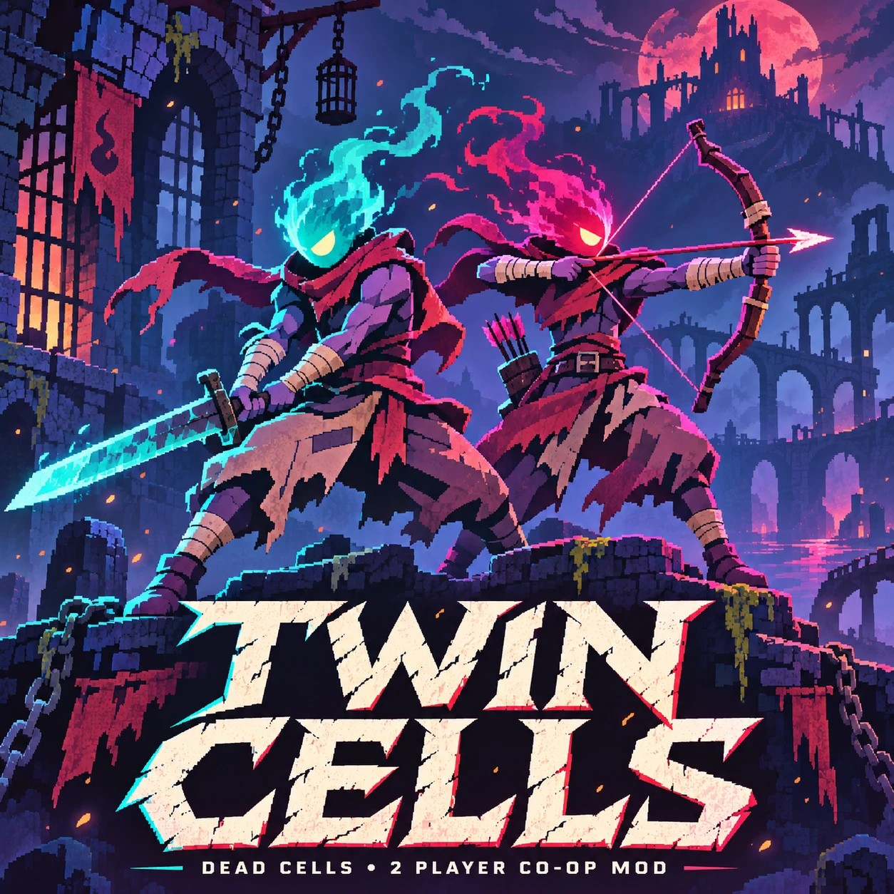

# Twin Cells

**Кооперативная переработка Dead Cells для двух игроков.** [English version](README.md)

Текущий выпуск: **Alpha2 · 0.2.0-alpha · 13 ноября 2026**, Windows x64. Сборка `3D0A5880`.

Twin Cells добавляет исправления и возможности к **DeadCellsMultiplayerMod 0.5.1** и работает через **Dead Cells Core Modding 35.13.5**. Все 30 частей собраны в один `CoopPack.dll`; в игре модуль пока сохраняет техническое имя **CoopPack**.

## Изменения относительно Alpha1

[Список исправлений Alpha2](docs/Alpha2-changelog-ru.md): бой с Привратником, «Комбо», стоимость воскрешения, звуки смерти врагов, видимость между комнатами, кат-сцены, лифты, двери переходов, геймпады, имена игроков, панель напарника и сообщения о версии, а также оптимизации синхронизации и выделения памяти.

## Установка и обновление

Скачайте **`TwinCells-Alpha2-Update-2026-11-13.zip`** со [страницы Alpha2](https://github.com/Avenged-7wrx/TwinCells/releases/tag/v0.2.0-alpha). Там же находятся русская инструкция и контрольная сумма SHA-256.

Если кооперативная копия с Alpha1 уже установлена:

1. Закройте Dead Cells Coop.
2. Полностью распакуйте ZIP в отдельную папку вне игры.
3. Перетащите существующую папку `DeadCells-Coop` на `Update-Coop-Alpha2.cmd`.
4. Дождитесь `UpdateCompleted`. `AlreadyUpdated` означает, что эта сборка уже установлена.
5. Запускайте игру привычным кооперативным ярлыком. **Обоим игрокам нужна Alpha2 сборки `3D0A5880`.**

Обновляются только `CoopPack.dll`, `modinfo.json` и запись установки. Сохранения и настройки сохраняются, прежние файлы остаются в `coop-fix-updates` для отката. Новая копия игры не создаётся. Если у вас уже установлено тестовое обновление Alpha2 сборки `3D0A5880`, переустановка не нужна.

Для проверки без изменений перетащите ту же папку на `Check-Coop-Alpha2.cmd`. Для отката закройте игру и используйте `Undo-Coop-Alpha2.cmd`; сохраните папку резервных файлов. После отката у обоих игроков должна быть одинаковая версия.

Для первой установки сначала используйте [полный установщик Alpha1](https://github.com/Avenged-7wrx/TwinCells/releases/tag/v0.1.0-alpha), затем это обновление Alpha2. Полный установщик создаёт начальную кооперативную копию из вашей игры Steam. Требуются своя Steam-копия Dead Cells v35, Windows 10/11 x64 и Microsoft .NET Runtime 10 x64. Установщик сверяет поддерживаемые версии файлов. На обоих ПК выключите `DebugPlayerImmortal` в настройках кооператива → Debug.

## Авторы и лицензии

- [DeadCellsMultiplayerMod](https://github.com/vaiserYT/DeadCellsMultiplayerMod), автор vaiserYT (Alexey), MIT — основа сетевой игры. Его DLL 0.5.1 используется без изменений; Twin Cells подключает дополнения и исправления во время работы игры.
- [Dead Cells Core Modding](https://github.com/dead-cells-core-modding/core), MIT — загрузчик модов.
- Dead Cells принадлежит Motion Twin / Evil Empire и другим правообладателям. Twin Cells — неофициальный любительский проект, не одобренный разработчиками игры или исходных модов.
- Собственный код Twin Cells распространяется по [MIT](LICENSE). Подробнее: [сведения о сторонних компонентах](THIRD-PARTY-NOTICES.md) и [тексты лицензий](licenses/third-party/README.md).

Репозиторий и обновление Alpha2 не содержат ресурсов игры. Базовый мод, DCCM и неизменённый рабочий модуль Steam остаются в существующей установке.

## Исходники и сборка

`src/` — точный снимок исходников выпущенного DLL Alpha2. В [`src/build-manifest.json`](src/build-manifest.json) зафиксированы 30 частей, порядок компиляции из 183 записей, хеши зависимостей и параметры компилятора. Полный SHA-256 DLL: `3D0A58807946E01A8E68683905EF96A7757185470476AFA5550FB09F6F58C2D1`.

Снимок содержит исходники частей, списки применённых правок, загрузчик пакета и зафиксированные входные данные. Инструменты сборки и игровых проверок пока находятся вне этого репозитория. Относительные пути и ссылки на рабочие материалы сохранены, потому что файлы снимка закреплены хешами. Выпуск собран через `Add-Type` PowerShell 7.6.9 с зависимостями DCCM 35.13.5, локально созданным GameProxy, базовым модом 0.5.1 и неизменённым Steam worker. Самостоятельно пересобранный DLL не считается автоматически взаимозаменяемым с опубликованным.

В [`installer/alpha2/`](installer/alpha2/) находятся исходники установщика обновления и метаданные выпуска. Готовый комплект прикреплён к релизу; двоичные файлы не хранятся в Git. Исходники Alpha1 доступны по тегу [`v0.1.0-alpha`](https://github.com/Avenged-7wrx/TwinCells/tree/v0.1.0-alpha).

## Сообщить о проблеме

Создайте [issue в Twin Cells](https://github.com/Avenged-7wrx/TwinCells/issues), указав сборку и шаги воспроизведения. Перед публикацией журналов или снимков удалите личные пути, имена игроков, Steam ID и IP-адреса.
